# private-journal

Single-user, 2FA-gated encrypted CLI journal. Entries, metadata, and file names stay encrypted on disk. Editing runs in sandboxed `nvim`, and search runs over a transient in-memory index via `fzf`.

## Overview

- **Private by default:** Every note, tag, timestamp, and filename is encrypted on disk (`Argon2id` Master Key, `HKDF-SHA256` per-file subkeys, `ChaCha20-Poly1305` AEAD, `HMAC-SHA256` filenames, `0600` permissions).
- **Two-factor unlock:** Sessions require both your password and a Google Authenticator `TOTP` code (`valid_window=1`, replay-checked), held in a local `0600` Unix-socket daemon with a 15-minute default timeout.
- **No accidental disk leaks:** Notes are edited in sandboxed `nvim` (`-n -i NONE`, `nobackup`/`noundofile`/`noswapfile`) inside `$XDG_RUNTIME_DIR`, then overwritten with zeros and deleted on exit.
- **Memory protection:** Keys live in `mlock`ed buffers that are zeroized on lock or timeout, with core dumps disabled (`RLIMIT_CORE=0`).
- **Fast local search:** Full-text, tag, and date-range search runs over a transient in-memory index using `fzf --no-history`—nothing is written to disk.

### Lifecycle Walkthrough



Replay locally with `asciinema play docs/demo.cast`, or regenerate with `mise run demo` (text transcript in [docs/demo.txt](docs/demo.txt)).

## Installation

Install the latest release with `pip`, `uv`, `pipx`, or `mise`:

```bash
# Direct wheel from GitHub Releases (no cloning):
pip install "https://github.com/pradyumnac/private-journal/releases/download/v0.1.2/private_journal-0.1.2-py3-none-any.whl"

# Isolated CLI install (floating @latest release tag):
uv tool install "git+https://github.com/pradyumnac/private-journal.git@latest"
pipx install "git+https://github.com/pradyumnac/private-journal.git@latest"
mise use -g "pipx:git+https://github.com/pradyumnac/private-journal@latest"
```

## User Documentation

### 1. First-Run Setup and Unlock

All operations except `setup`, `unlock`, `lock`, `status`, `--help`, and `--version` require an active unlocked session.

```bash
pj setup                         # (alias: su) Initialize password + TOTP (--reset to replace)
pj unlock                        # (alias: ul) Start timed session
```

`pj setup` prompts for a vault password and prints the TOTP secret and `otpauth://` provisioning URI for Google Authenticator. It rejects re-initialization unless `--reset` is passed and confirmed.

### 2. Creating, Viewing, Editing, and Deleting Entries

`pj new` prints the new entry `<id>` on save, though you rarely need to type it:
- `pj view`, `pj edit`, and `pj delete` launch `fzf` automatically when `<id>` is omitted, and accept any unique ID prefix (e.g., `pj v d00c`).
- `pj search` supports `Enter` (view), `Ctrl-E` (edit), and `Ctrl-D` (delete) directly inside `fzf`.
- `pj delete` prompts for confirmation unless `--yes` (`-y`) is passed.

```bash
pj new --tag work --tag notes   # (alias: n)  Create an entry in sandboxed nvim (prints <id>)
pj view [id_or_prefix]           # (alias: v)  Display entry (uses fzf if omitted)
pj edit [id_or_prefix]           # (alias: e)  Edit entry (uses fzf if omitted)
pj delete [id_or_prefix] [--yes] # (alias: d, rm) Delete entry (uses fzf if omitted)
pj completion bash|zsh|fish      # Generate shell autocompletion script
```

### 3. Searching and Listing

`list` is folded into `search`. Search runs against a transient in-memory index (never written to disk) and uses `fzf --no-history`.

```bash
pj search                        # Interactive fzf list (select opens view)
pj search "argon2" --tag security
pj search --after 2026-01-01 --before 2026-12-31
pj search --edit                 # Open selected entry in nvim
pj search --id                   # Print selected entry ID
pj search --plain                # Non-interactive stdout output
```

### 4. Session and Configuration

```bash
pj status                        # Show lock state and remaining TTL
pj lock                          # Lock immediately and wipe session memory
pj config get unlock_timeout     # Read config (default: 15m)
pj config set unlock_timeout 30m # Update unlock timeout
pj config set data_dir ~/vault   # Set custom vault directory
```

## Development

```bash
mise run test                    # Run pytest suite
mise run demo                    # Record asciinema cast and render SVG demo
mise run bump                    # Bump version (patch|minor|major), lock, commit, and push
mise run release                 # Verify clean synced tree + tests + demo, build, tag, and release
uv run python scripts/demo_lifecycle.py -v --fast  # Run isolated /tmp lifecycle demo
```
